# Prompt: Logo mở đầu "portfolio" thành "puc" cùng con cáo pixel

Tài liệu này mô tả đầy đủ đoạn hoạt hình chạy khi người xem vừa vào trang. Đưa nguyên file cho người làm chuyển động, cho công cụ AI, hoặc dùng làm bảng phân cảnh để tự vẽ.

> **Cập nhật 2026-11-24:** chữ đổi sang chữ giấy cắt giống logo "puc" trên bản đồ (Paytone One, cam cáo `#d9661c`, bóng cứng `#9a4313`, mỗi chữ cái xoay lệch). Chữ u và c dùng chữ thật của Paytone One: khi cáo phá chữ o, chữ đổi hẳn sang u hoặc c, kèm mảnh bìa văng (người dùng chê kiểu tự cắt từ chữ o). Đã gắn vào bản đồ: `city/engine/logo-intro.js` (xem `city/README.md`). Bản thử độc lập: [demo/index.html](demo/index.html), mở qua máy chủ ở thư mục gốc dự án (`python3 -m http.server 8771`, rồi vào `/design/logo-intro/demo/`).

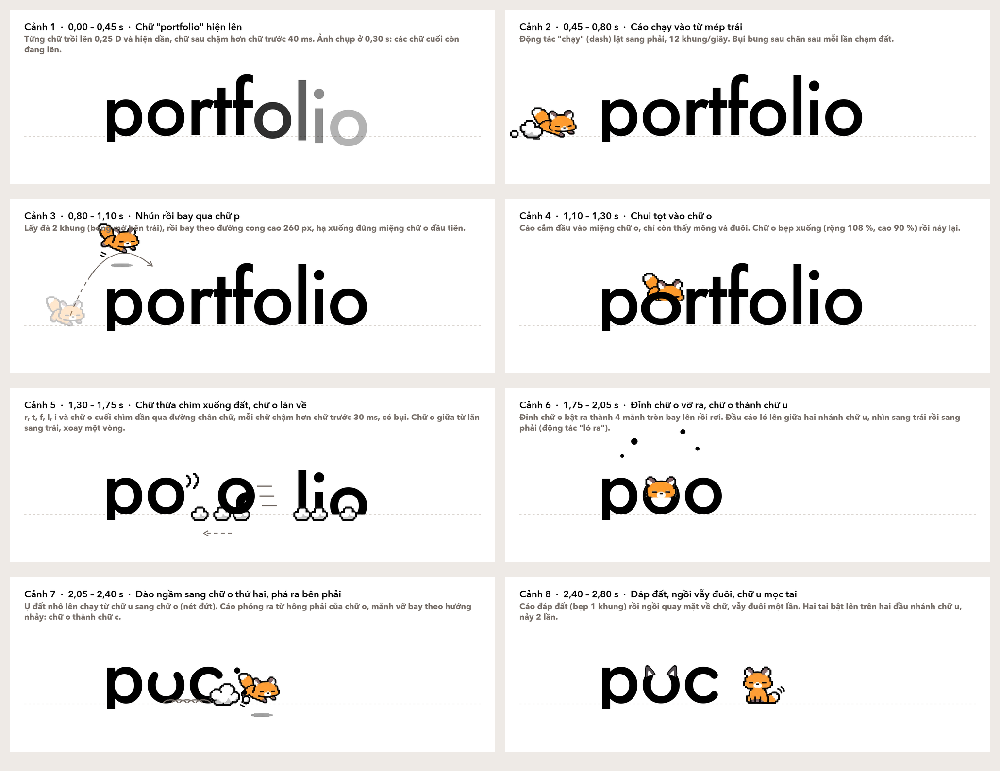

---

## 1. Ý tưởng trong một câu

Chữ **portfolio** hiện lên. Con cáo pixel chạy vào, nhảy qua chữ **p** và chui vào chữ **o** đầu tiên như chui vào hang. Các chữ thừa chìm xuống đất. Cáo phá **đỉnh** chữ o thứ nhất để thò đầu lên, biến nó thành chữ **u**. Rồi cáo đào ngầm sang chữ o thứ hai và phá **hông phải** của nó, biến nó thành chữ **c**. Kết thúc là chữ **puc**, chữ u có hai tai cáo, con cáo ngồi cạnh vẫy đuôi.

**Vì sao các chữ liên kết với nhau:**
- Chữ **p** đứng đầu cả "portfolio" lẫn "puc" nên giữ nguyên, không biến đổi.
- Chữ **u** chính là chữ o bị đục thủng phía trên. Chữ **c** là chữ o bị đục thủng một bên.
- Mọi biến đổi đều do con cáo gây ra, không có chữ nào tự mờ đi rồi hiện chữ khác.

---

## 2. Quy định chung

| Mục | Quy định |
|---|---|
| Tổng thời lượng | 2,8 giây hoạt hình, giữ logo cuối 0,6 giây, thu logo lên thanh đầu trang 0,45 giây. Tổng cộng 3,85 giây. |
| Khi nào chạy | Chỉ ở lần vào trang đầu tiên trong mỗi phiên. Tải lại trang trong cùng phiên thì hiện thẳng logo. |
| Bỏ qua | Bấm, chạm, cuộn hoặc nhấn phím bất kỳ thì nhảy ngay tới logo cuối, rồi thu lên đầu trang. |
| Giảm chuyển động | Máy bật `prefers-reduced-motion` thì không chạy hoạt hình. Hiện thẳng logo cuối (mục 6), mờ dần vào trong 200 ms. |
| Âm thanh | Không có. |
| Sân khấu | Toàn màn hình, nền theo màu nền của trang. Cụm chữ nằm giữa theo chiều ngang, đường chân chữ ở 55 % chiều cao màn hình. |
| Đơn vị đo | **D** là đường kính ngoài của chữ o. Mọi khoảng cách trong tài liệu tính theo D, để phóng to thu nhỏ không lệch. |
| Hai thế giới hình ảnh | **Chữ là vector, nét mượt.** **Chỉ con cáo và hiệu ứng của nó (bụi, vạch rung) là pixel.** Không làm chữ thành pixel, không làm cáo mượt đi. |

---

## 3. Kiểu chữ

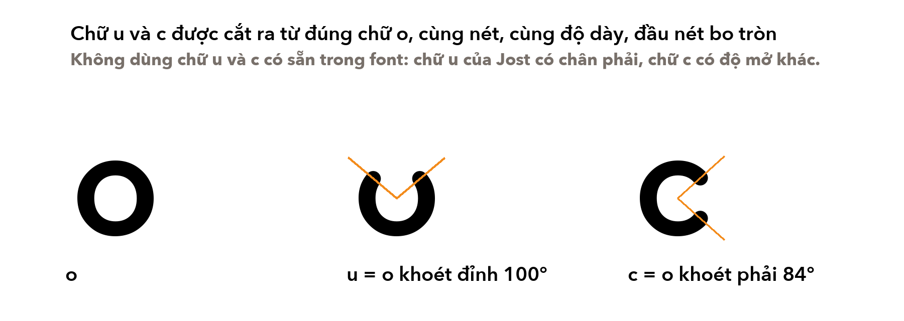

### 3a. Font

| Mục | Quy định |
|---|---|
| Font | **Jost**, độ đậm 500 (Medium). Font miễn phí trên Google Fonts, giấy phép OFL. |
| Vì sao chọn | Chữ o của Jost là hình tròn gần tuyệt đối, nét đều, nên cắt ra u và c vẫn đẹp. Font hình học này cũng hợp với dáng tròn, mập của con cáo. |
| Hình minh hoạ | Dùng Futura Medium, gần giống Jost vì Jost được làm theo Futura. |
| Chữ | Viết thường toàn bộ: `portfolio`, `puc`. |
| Khoảng cách chữ | −0,02 em, chữ hơi khít. |
| Cỡ chữ | Cỡ chữ được chọn sao cho D (đường kính chữ o) bằng 1,25 lần bề ngang đầu cáo. Trên máy tính, D khoảng 76 px, tương ứng cỡ chữ khoảng 150 px. Trên điện thoại, D khoảng 48 px. |
| Màu chữ | Đen `#000000`, cùng màu viền cáo. Nếu trang dùng nền tối thì chữ đổi sang màu sáng của trang; tai trên chữ u vẫn giữ màu xám và trắng. |

### 3b. Chữ u và c: tự dựng, không dùng chữ có sẵn trong font

Chữ u của Jost có chân bên phải, và độ mở của chữ c cũng khác hẳn. Vì vậy hai chữ này phải **cắt ra từ chính chữ o** của Jost, để người xem thấy rõ chữ o bị phá ra.

| Chữ | Cách dựng | Đầu nét |
|---|---|---|
| **u** | Khoét một khe ở **đỉnh** chữ o, tâm khe ở góc 12 giờ, rộng **100°**, tức mỗi bên 50°. | Hai đầu nét bo tròn, đường kính bằng độ dày nét. |
| **c** | Khoét một khe ở **bên phải** chữ o, tâm khe ở góc 3 giờ, rộng **84°**, tức mỗi bên 42°. | Bo tròn, giống chữ u. |

Xuất u và c thành hai đường SVG riêng. Mỗi chữ cần hai trạng thái có cùng số điểm neo, để hoạt hình chuyển được từ o sang u và từ o sang c: trạng thái "khe = 0°" (vẫn là chữ o) và trạng thái "khe đầy đủ".

### 3c. Tai cáo trên chữ u

| Mục | Quy định |
|---|---|
| Kiểu | **Vector**, không phải pixel. Đây là phần của logo, sống cùng thế giới với chữ. |
| Dáng | Tam giác đầu tròn, chân rộng. Chân rộng 0,40 D, cao 0,36 D. |
| Màu | Viền đen `#000000` dày bằng 0,08 lần độ dày nét chữ (nhìn kỹ mới thấy). Lòng xám `#544E52`. Phần trắng `#FFFFFF` là một tam giác nhỏ ở chân tai, cao bằng một nửa tai. Đây đúng là màu tai của con cáo. |
| Vị trí | Chân tai ngồi trên hai đầu nhánh chữ u. Mỗi tai nghiêng ra ngoài 20°. |

---

## 4. Màu

| Tên | Mã | Dùng cho |
|---|---|---|
| Đen | `#000000` | Chữ, viền cáo, viền tai, mảnh vỡ |
| Cam | `#F38C1D` | Lông cáo |
| Xám | `#544E52` | Tai cáo, tai trên chữ u |
| Trắng | `#FFFFFF` | Lòng tai, mõm, chóp đuôi |
| Xám bóng | `#A6A6A6`, độ trong 60 % | Bóng cáo dưới đất |
| Nền | Theo phong cách trang (chưa chốt). Hình minh hoạ dùng trắng. | Sân khấu |

Không thêm màu nào khác. Không dùng dải chuyển màu, không phát sáng, không đổ bóng chữ.

---

## 5. Con cáo

> **Cập nhật:** đoạn mở đầu sẽ dùng bộ cáo vẽ mới, nhiều khung hơn. Danh sách 19 động tác, mô tả từng khung và thời gian mới (khoảng 4,5 giây) nằm ở [CAO-CAN-VE.md](CAO-CAN-VE.md). Bảng bên dưới là bộ khung hiện có, dùng để minh hoạ cho tới khi có bộ mới.

| Mục | Quy định |
|---|---|
| Nguồn | Các khung trong `pet/sprites/*.png`, cắt thẳng từ ảnh gốc, không chỉnh sửa. Mỗi tệp là một động tác, các khung xếp ngang. Thông tin khung nằm trong `pet/sprites/fox.json`. |
| Hướng | Ảnh gốc nhìn sang trái. Trong đoạn mở đầu, cáo đi từ trái sang phải nên **lật ngang** ảnh. Riêng cảnh cuối, cáo ngồi quay mặt về phía chữ nên dùng ảnh gốc, không lật. |
| Cỡ | Phóng to hoặc thu nhỏ theo **số nguyên lần**, hoặc đúng 0,5 lần. Luôn dùng `image-rendering: pixelated`. |
| Vị trí theo pixel | Toạ độ của cáo làm tròn tới điểm ảnh, để nét không bị nhòe khi di chuyển. |
| Nhịp khung | Theo bảng ở mục 7. Cáo đổi khung theo nhịp riêng của nó, còn vị trí thì di chuyển mượt theo đường cong. |
| Bóng | Vẽ riêng trên mặt đất bằng `fx-shadow.png`. Bóng nhỏ lại khi cáo bay cao: cỡ 3 khi đứng đất, cỡ 2 khi cao 0,5 D, cỡ 1 khi cao hơn 1 D. |

Động tác dùng trong đoạn mở đầu:

| Tệp | Số khung | Dùng ở cảnh |
|---|---|---|
| `dash.png` | 6 | 2, chạy vào |
| `crouch.png` | 2 | 3, lấy đà |
| `leap.png` | 3 | 3, bay qua chữ p; 7, phóng ra khỏi chữ c |
| `dig.png` | 5 | 4, cắm đầu vào chữ o |
| `peek.png` | 4 | 6, ló đầu khỏi chữ u |
| `land.png` | 1 | 8, đáp đất |
| `idle.png` | 4 | 8, ngồi |
| `wag.png` | 4 | 8, vẫy đuôi |
| `fx-dust.png` | 5 | Bụi khi chạy, khi chui, khi chữ chìm |
| `fx-shake.png` | 3 | Vạch rung khi chữ o rung |
| `fx-shadow.png` | 3 | Bóng dưới đất |

---

## 6. Logo cuối

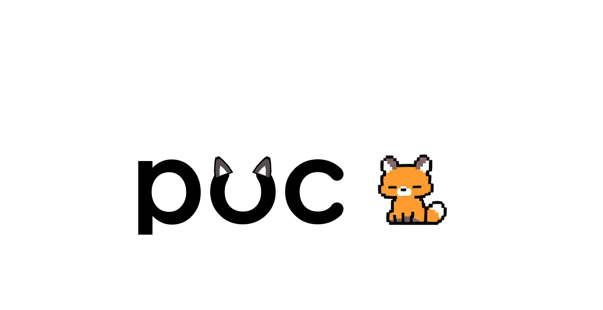

- Chữ **puc**: chữ p của Jost, chữ u và c tự dựng như mục 3b, hai tai vector trên chữ u.
- Cáo ngồi bên phải chữ c, cách chữ c 0,9 D, chân trên đường chân chữ, quay mặt về phía chữ.
- **Biến thể chỉ có chữ** (thanh đầu trang, chân trang): "puc" kèm tai, không có cáo.
- **Biểu tượng nhỏ** (favicon, ảnh đại diện): chỉ chữ u có tai. Ở 16 px thì bỏ phần trắng trong lòng tai.
- **Khoảng trống quanh logo**: ít nhất 0,5 D mỗi phía.

---

## 7. Phân cảnh chi tiết

Thời gian tính từ lúc trang sẵn sàng. Đường cong chuyển động viết theo `cubic-bezier` của CSS.

Tên gọi các đường cong:
- **Ra mượt**: `cubic-bezier(0.2, 0.8, 0.2, 1)`
- **Vào nhanh**: `cubic-bezier(0.55, 0, 1, 0.45)`
- **Nảy**: `cubic-bezier(0.34, 1.56, 0.64, 1)`
- **Hai đầu chậm**: `cubic-bezier(0.65, 0, 0.35, 1)`

### Cảnh 1. 0,00 – 0,45 s. Chữ "portfolio" hiện lên

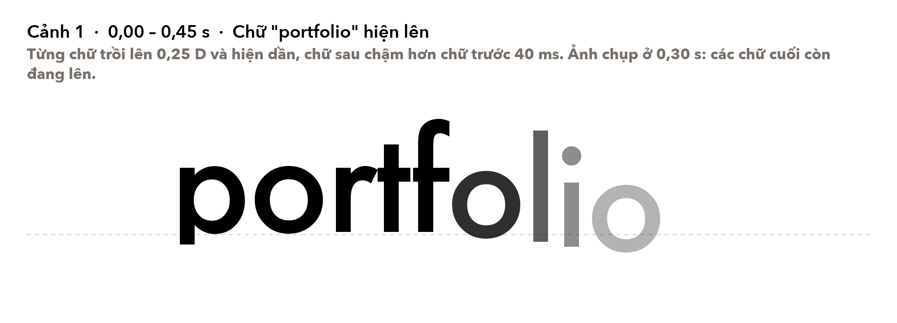

- **Từng chữ:** trồi từ dưới lên 0,25 D và hiện từ trong suốt sang rõ. Mỗi chữ mất 360 ms, theo đường **Ra mượt**.
- **Lần lượt:** chữ sau bắt đầu chậm hơn chữ trước 40 ms, từ p tới o cuối.
- **Không thêm gì khác:** không có con trỏ gõ chữ, không có vạch kẻ chạy qua.
- **Cuối cảnh:** chữ đứng yên trên đường chân chữ. Con cáo chưa xuất hiện.

### Cảnh 2. 0,45 – 0,80 s. Cáo chạy vào từ mép trái

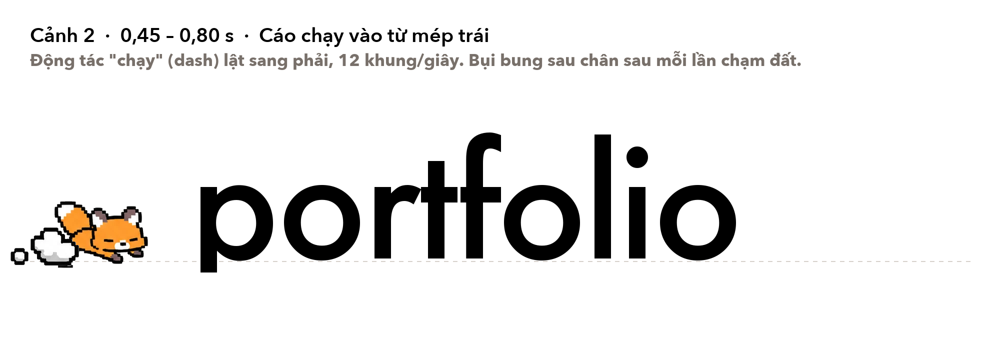

- **Chạy:** cáo dùng `dash.png`, lật sang phải, 12 khung/giây, lặp. Cáo xuất phát từ ngoài mép trái màn hình và chạy đều tới điểm cách chữ p 1,2 D về bên trái. Tốc độ 9 D mỗi giây, hơi chậm lại ở 80 ms cuối.
- **Bụi:** mỗi lần chân sau chạm đất (khung 1 và 4 của `dash.png`) thì bung một cụm bụi `fx-dust` khung 0 rồi 1, đặt sau chân, lật cùng chiều cáo, hiện 160 ms.
- **Bóng:** bóng cỡ 3 đi theo dưới cáo.

### Cảnh 3. 0,80 – 1,10 s. Nhún rồi bay qua chữ p

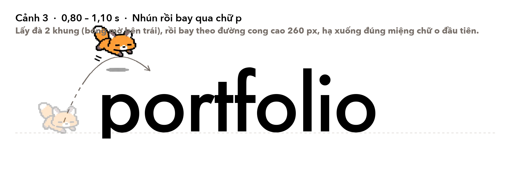

- **0,80 – 0,92 s, lấy đà:** `crouch.png` khung 0 rồi 1, mỗi khung 60 ms. Cáo đứng yên tại chỗ.
- **0,92 – 1,10 s, bay:** `leap.png` khung 0 (lên), 1 (đỉnh), 2 (xuống), mỗi khung khoảng 60 ms.
- **Đường bay:** parabol từ chỗ lấy đà tới **miệng chữ o đầu tiên**, tức điểm cao nhất của chữ o. Đỉnh parabol cao 1,7 D so với đường chân chữ, nằm ngay trên chữ p. Theo chiều ngang cáo đi đều; theo chiều dọc lên chậm dần, xuống nhanh dần.
- **Bóng:** nhỏ dần theo độ cao như mục 5.
- **Chữ p:** khi cáo bay qua, chữ p hơi cúi xuống 2 % chiều cao trong 100 ms rồi bật lại, như bị gió thổi.

### Cảnh 4. 1,10 – 1,30 s. Chui tọt vào chữ o

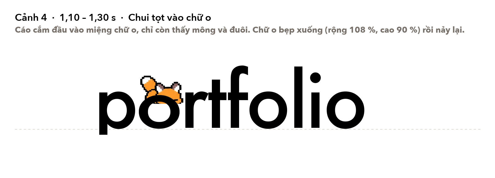

- **Cắm đầu xuống:** cáo đổi sang `dig.png` khung 1, lật, đầu chúc xuống đúng miệng chữ o.
- **Che phần đã chui vào:** phần thân cáo thấp hơn đỉnh chữ o 0,25 D bị che đi (dùng mặt nạ). Chữ o vẽ đè lên trên cáo, nên trông như cáo chui vào trong.
- **Chui sâu dần:** trong 200 ms cáo tụt xuống 0,6 D, chỉ còn mông và đuôi rồi mất hẳn. Đuôi biến mất sau cùng, quẫy 1 lần.
- **Chữ o bẹp:** bề ngang thành 108 %, chiều cao 90 % trong 100 ms (giữ chân chữ cố định), rồi về 100 % trong 160 ms theo đường **Nảy**.
- **Bụi:** một cụm `fx-dust` khung 0 bật lên ở miệng chữ o.

### Cảnh 5. 1,30 – 1,75 s. Chữ thừa chìm xuống, chữ o lăn về

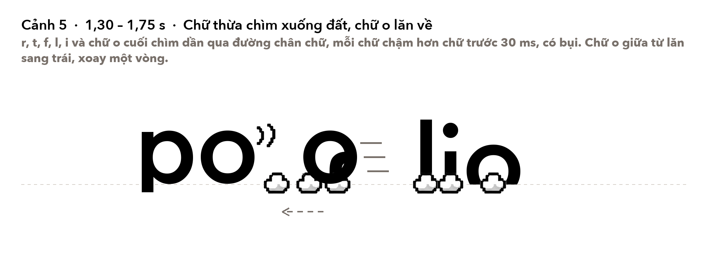

- **Chữ o thứ nhất (sẽ thành u):** rung ngang ±0,03 D, 4 lần trong 300 ms. Vạch rung `fx-shake` hiện hai bên.
- **Chữ chìm:** các chữ `r`, `t`, `f`, `l`, `i` và chữ `o` cuối chìm thẳng xuống, mỗi chữ mất 260 ms theo đường **Vào nhanh**. Thứ tự từ `r` tới `o` cuối, chữ sau chậm hơn chữ trước 30 ms. Mọi phần nằm dưới đường chân chữ đều bị che, nên chữ trông như lún xuống đất.
- **Bụi khi chìm:** mỗi chữ chìm làm bung một cụm `fx-dust` khung 0 ngay trên mặt đất, chỗ chữ đó.
- **Chữ o thứ hai** (chữ o ở giữa từ, ngay trước chữ l): lăn sang trái tới vị trí sát sau chữ o thứ nhất (khoảng cách giữa hai chữ giống hai chữ o liền nhau trong font). Vừa trượt vừa quay ngược chiều kim đồng hồ đúng một vòng, mất 380 ms theo đường **Hai đầu chậm**. Có 3 vạch tốc độ ngắn phía sau chữ.
- **Sau cảnh này:** màn hình chỉ còn `p o o` đứng sát nhau.

### Cảnh 6. 1,75 – 2,05 s. Đỉnh chữ o vỡ ra, thành chữ u

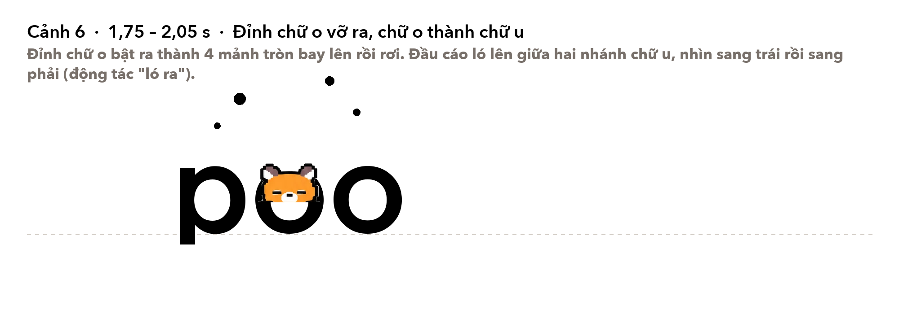

- **1,75 s, phá đỉnh:** đỉnh chữ o vỡ. Khe 100° mở ra ngay lập tức, không mở từ từ. Bốn mảnh tròn màu đen, đường kính 0,08 đến 0,15 D, bắn lên cao 0,6 đến 1,1 D, toả ra hai bên, rơi theo trọng lực, mờ dần trong 400 ms.
- **Hai nhánh chữ u:** nảy lên 6 % rồi về chỗ trong 160 ms theo đường **Nảy**. Từ giây này, chữ là **u**.
- **Đầu cáo ló lên:** `peek.png` khung 0 tới 3, lật, 10 khung/giây, đặt chính giữa hai nhánh chữ u. Đầu cáo vẽ đè lên chữ. Phần dưới cằm bị che bằng mặt nạ ngang tâm chữ u, nên trông như cáo đứng trong lòng chữ.
- **Nhìn quanh:** giữ khung 3 trong 120 ms, rồi chạy ngược khung 3 về 0 trong 100 ms. Đầu cáo thụt xuống, chữ u để trống.

### Cảnh 7. 2,05 – 2,40 s. Đào ngầm sang chữ o thứ hai, phá ra bên phải

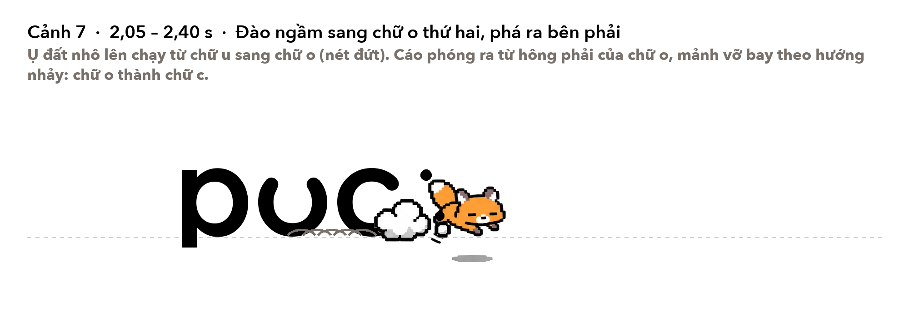

- **2,05 – 2,20 s, đào ngầm:** một ụ đất nhỏ chạy dưới đường chân chữ, từ chữ u sang chữ o thứ hai. Ụ đất là một cung xám `#544E52`, cao 0,12 D, rộng 0,4 D. Hai cụm `fx-dust` nhỏ nhảy theo ụ đất.
- **Chữ o thứ hai:** rung ±0,03 D, 2 lần.
- **2,20 s, phá hông phải:** hông phải chữ o vỡ, khe 84° mở ngay. Ba mảnh tròn bắn **sang phải**, theo hướng cáo nhảy. Từ giây này, chữ là **c**.
- **Cáo phóng ra:** từ trong chữ c ra bên phải bằng `leap.png` khung 0 tới 2, lật. Đường bay là parabol thấp, cao 1,0 D, dài 1,8 D.
- **Bụi:** `fx-dust` khung 2 (cụm to) bung ngay chỗ vừa phá.

### Cảnh 8. 2,40 – 2,80 s. Đáp đất, ngồi vẫy đuôi, chữ u mọc tai

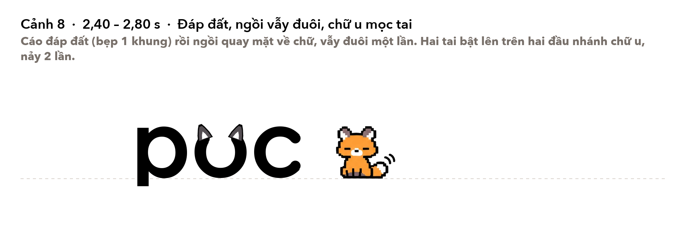

- **2,40 s, đáp đất:** `land.png` giữ 90 ms. Cáo bẹp xuống đúng 1 khung, không co giãn ảnh. Bụi `fx-dust` khung 0 bung hai bên chân.
- **2,49 s, ngồi:** chuyển sang `idle.png` khung 0, **không lật**, quay mặt về phía chữ. Vị trí cách chữ c 0,9 D.
- **2,55 – 2,80 s, vẫy đuôi:** `wag.png` khung 0 tới 3, 12 khung/giây, chạy 1 lần.
- **2,50 s, tai mọc:** hai tai vector mọc lên trên hai đầu nhánh chữ u, tai trái trước tai phải 60 ms. Mỗi tai phóng từ 0 lên 115 %, xuống 95 %, rồi về 100 %, mất 320 ms, gốc phóng ở chân tai.
- **2,80 – 3,40 s:** giữ nguyên logo cuối.

### Sau cảnh 8. 3,40 – 3,85 s. Thu logo lên đầu trang

- **Chữ:** cụm "puc" kèm tai thu nhỏ và bay lên vị trí logo trên thanh đầu trang, cao 32 px, mất 450 ms theo đường **Hai đầu chậm**.
- **Cáo:** cáo không bay theo. Nó đứng dậy, chạy (`dash.png`) xuống góc dưới trang và từ đó trở thành con vật cưng của trang.
- **Nội dung trang:** hiện dần trong 300 ms, bắt đầu từ 3,55 s.

---

## 8. Bảng thời gian tóm tắt

| Thời điểm | Chữ | Cáo | Hiệu ứng |
|---|---|---|---|
| 0,00 | portfolio trồi lên lần lượt | chưa có | |
| 0,45 | đứng yên | chạy vào | bụi chân |
| 0,80 | đứng yên | lấy đà | |
| 0,92 | p cúi theo gió | bay qua p | bóng nhỏ dần |
| 1,10 | o thứ nhất bẹp rồi nảy | chui vào o | bụi miệng hang |
| 1,30 | r t f l i o chìm; o giữa từ lăn về | ở trong hang | vạch rung, bụi |
| 1,75 | o thành u | ló đầu, thụt xuống | 4 mảnh vỡ |
| 2,05 | o thứ hai rung | đào ngầm | ụ đất, bụi |
| 2,20 | o thành c | phóng ra bên phải | 3 mảnh vỡ, bụi to |
| 2,40 | | đáp đất | bụi chân |
| 2,50 | u mọc tai | ngồi, vẫy đuôi | |
| 3,40 | thu lên đầu trang | chạy xuống góc trang | |

---

## 9. Màn hình nhỏ

- **Cùng kịch bản, cùng thời gian.** D khoảng 48 px, cáo hiện 0,5 lần.
- **Chiều ngang:** cụm "portfolio" rộng khoảng 7,6 D. Nếu màn hình hẹp hơn 8,5 D thì thu D lại cho vừa, giữ lề ít nhất 16 px mỗi bên.
- **Đường bay:** cao 1,4 D thay vì 1,7 D, để cáo không chạm mép trên.

---

## 10. Không được làm

- Không làm chữ thành pixel. Không làm cáo mượt đi, không xoay hay co giãn ảnh cáo theo tỉ lệ lẻ.
- Không dùng chữ u và c có sẵn trong font.
- Không để chữ mờ đi rồi chữ khác hiện lên. Mọi thay đổi phải do cáo gây ra.
- Không thêm hiệu ứng phát sáng, hạt lấp lánh, dải màu hay đổ bóng chữ.
- Không vượt quá 4 giây. Không chạy lại mỗi lần chuyển trang.
- Không để cáo đứng chồng lên chữ ở logo cuối.

---

## 11. Bàn giao

| Thứ cần giao | Định dạng |
|---|---|
| Chữ p, o, u, c và tai | SVG. u và c mỗi chữ có hai trạng thái cùng số điểm neo. |
| Đoạn mở đầu | HTML, CSS, JS tự viết, hoặc Rive. Không dùng video, vì video không giữ được nét pixel của cáo và không bỏ qua được. |
| Bản xem trước | MP4 1920 × 1080 nền trắng, kèm một bản nền tối. |
| Logo cuối | SVG, hai bản có cáo và không có cáo. Kèm favicon 16, 32, 180 px. |

---

## 12. Prompt ngắn cho công cụ AI

**Tiếng Việt**

> Hoạt hình mở đầu website dài 2,8 giây, nền trắng, phong cách tối giản. Chữ "portfolio" viết thường bằng font hình học Jost Medium màu đen hiện lên lần lượt từng chữ. Một con cáo pixel art nhỏ màu cam, viền đen, tai xám, mắt nhắm dạng gạch ngang, chạy vào từ bên trái, nhảy qua chữ "p" và chui vào chữ "o" đầu tiên như chui vào hang. Các chữ r, t, f, l, i và chữ o cuối chìm xuống đất. Chữ o ở giữa từ lăn về đứng cạnh chữ o đầu tiên. Cáo phá đỉnh chữ o đầu tiên, thò đầu lên, biến nó thành chữ "u". Rồi cáo đào ngầm sang chữ o thứ hai, phá hông phải để phóng ra, biến nó thành chữ "c". Kết thúc: chữ "puc", chữ u có hai tai cáo vector màu xám trắng, con cáo pixel ngồi bên phải vẫy đuôi. Chữ là vector mượt, chỉ con cáo là pixel art nét rõ.

**English**

> A 2.8-second website intro animation on a plain white background, minimal style. The lowercase word "portfolio" in a geometric sans (Jost Medium), solid black, rises in letter by letter. A small pixel-art fox (orange fur, black outline, grey ears, closed eyes drawn as short dashes) runs in from the left, hops over the "p" and dives head-first into the first "o" like a burrow. The letters r, t, f, l, i and the last o sink into the ground. The middle "o" rolls left to sit beside the first one. The fox bursts through the top of the first "o", turning it into a "u", peeks out, ducks back down, tunnels underground to the second "o" and bursts out through its right side, turning it into a "c". Final frame: the word "puc", with two small vector fox ears (grey with white inner) on top of the "u"; the pixel fox sits to the right wagging its tail. The letters are smooth vector shapes; only the fox and its dust puffs are crisp pixel art, never blurred.

---

## 13. Tệp liên quan

- Hình minh hoạ: `design/logo-intro/img/`
- Công cụ vẽ hình minh hoạ: `design/logo-intro/tools/storyboard.py`. Chạy lại khi đổi font hoặc đổi khung cáo:

  ```bash
  uv run --with pillow --with numpy python design/logo-intro/tools/storyboard.py
  ```
- Ảnh cáo: `pet/sprites/`
- Kế hoạch làm cáo chi tiết hơn: `pet/KE-HOACH-CAO.md`
